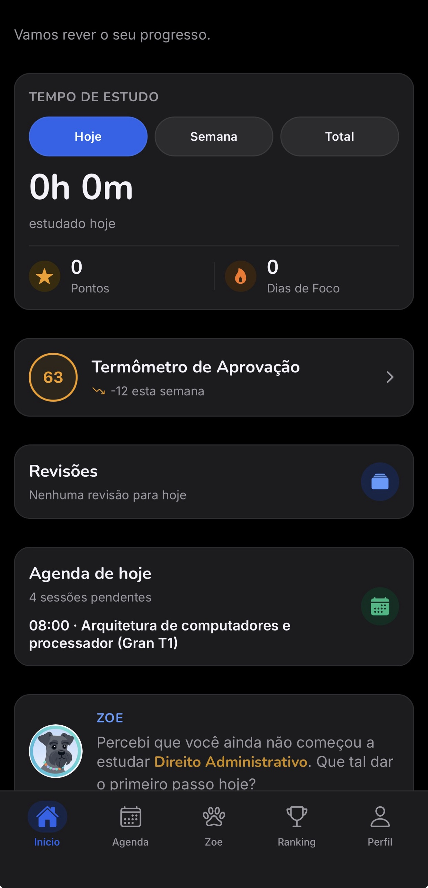
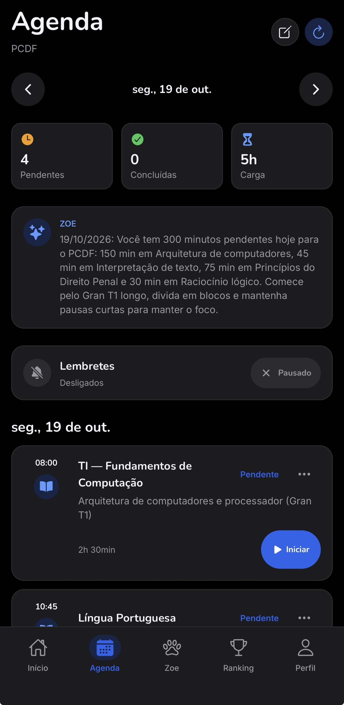
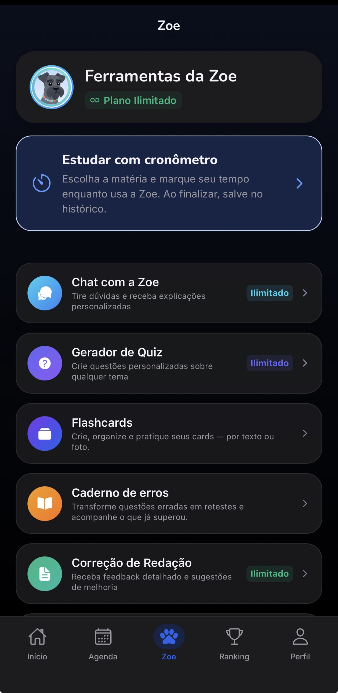
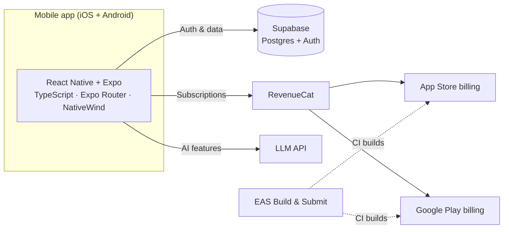

# Memo — AI Study Companion

**Memo** is a mobile study app for people preparing for Brazil's highly competitive public-service exams (*concursos públicos*). It combines proven learning techniques with AI to help students study smarter and keep a consistent routine.

> 🔒 The source code is private (commercial product). This repository documents the product, architecture and engineering decisions.

  
  &nbsp;
  

  
  &nbsp;
  
  &nbsp;
  

Home dashboard · AI-planned study schedule · AI tools (app UI in Portuguese)

---

## ✨ Features

| Area | What it does |
|---|---|
| **Spaced repetition** | Schedules reviews so students revisit content right before they forget it |
| **Flashcards** | Create cards from text or a photo and review them on a spaced-repetition schedule |
| **Error notebook** | Turns missed questions into retests and tracks what the student has overcome |
| **AI tutor ("Zoe")** | Chat for explanations, quiz generator on any topic, summaries, essay correction and a daily study briefing |
| **Approval meter** | A readiness score for the target exam, showing its weekly change |
| **Exam analysis** | Breaks down an exam notice (*edital*) into a structured study plan |
| **Mock exams** | Full simulated exams that mirror the real test format |
| **Focus tools** | Pomodoro and stopwatch for tracked study sessions |
| **Analytics dashboard** | Points, focus time and study time over time |
| **Weekly leaderboard** | Global and group rankings to keep students motivated |

---

## 🏗️ Architecture

**Stack**

- **App:** React Native, Expo, TypeScript, Expo Router (file-based navigation), NativeWind v4 (Tailwind styling)
- **Backend:** Supabase — Postgres database and authentication
- **Payments:** RevenueCat on top of App Store and Google Play subscriptions (monthly and yearly plans, free trial)
- **Delivery:** EAS Build and EAS Submit for both stores
- **Ads attribution:** Meta SDK + RevenueCat events (attribution only — the app shows no ads)

---

## 🔧 Engineering highlights

- **Swift → React Native migration.** Memo started as a native iOS app in Swift. In 2026 I rewrote it as a single Expo/TypeScript codebase, which brought it to Android and let every new feature ship to both platforms at once.
- **Cross-store subscriptions.** Implemented monthly and yearly plans with introductory free trials on both stores through RevenueCat, including price changes that keep existing subscribers on their original price.
- **Low-cost AI.** Designed the AI features around a lightweight model and compact prompts, keeping AI cost per user very low.
- **Shipping and compliance.** Handled App Store and Google Play reviews end to end: privacy declarations (App Privacy, Data Safety), App Tracking Transparency, Android developer verification and store listings.

---

## 📈 Status

- ✅ Live on the **App Store** and **Google Play**
- ✅ Approved in both store reviews, with **active paying subscriptions**
- 🇧🇷 Currently available in Brazil (Portuguese)

---

## 👤 Author

**Gabriel Weyers** — sole developer
[GitHub](https://github.com/Gaad25) · [LinkedIn](https://www.linkedin.com/in/gabrielweyers/)
